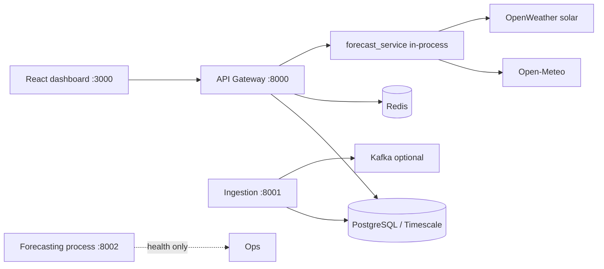

# Bria codebase guide

Living description of the repository as implemented. The root [`README.md`](../README.md) remains the original Technical Requirements Document (TRD); where TRD intent and code diverge, **this guide wins**.

**App version:** 2.0.0 (see `backend/core/config.py`, `frontend/dashboard/package.json`).

---

## 1. Purpose

Bria is a multi-tenant renewable generation forecasting platform: operators manage solar, wind, and hybrid sites; the system fetches weather, runs physics-based power models, and exposes forecasts through a FastAPI gateway and a React (MUI) dashboard.

**In scope in code today**

- Site CRUD with tenant isolation
- Honest power forecasts (Open-Meteo primary, OpenWeather solar failover; no synthetic capacity curves)
- Default solar model: nameplate yield (`SOLAR_NAMEPLATE_YIELD=true` → `model_version: nameplate-v1`)
- Weather history / current / forecast helpers
- Alerts, accuracy, scheduling, adjustments, scenarios, insights endpoints
- Site-bound technology recommendation and Plan-page recommendation runs (selection service)
- Load profiles, vendor catalogue admin APIs (`role=admin`)
- Light ops-shell dashboard (Sites, Plan, Forecasts, Alerts; Admin nav for `role=admin`)

**Out of scope or stubbed**

- SCADA control and market bidding
- Full SystemAdmin UI (page stub; vendor admin is API-backed)
- Heavy ML training in the live path (`train_model.py` is a registry CLI stub)

---

## 2. Repository map

```text
Bria/
├── backend/
│   ├── api-gateway/          # FastAPI app (hyphenated; runtime entry)
│   ├── api_gateway/          # Import wrapper for pytest (execs api-gateway/main.py)
│   ├── core/                 # Settings, DB, models, repositories, cache, logging
│   ├── services/
│   │   ├── forecasting/      # Forecast engine + weather providers; thin :8002 health
│   │   ├── ingestion/        # MQTT/HTTP/WS ingest; :8001
│   │   └── selection/        # Technology recommendation library
│   ├── database/migrations/  # 001–006 SQL
│   ├── scripts/              # Admin user, DB helpers
│   └── tests/
├── frontend/dashboard/       # CRA + react-app-rewired, React 18, MUI 5
├── docs/                     # This guide and ops docs
├── monitoring/
├── docker-compose.yml
├── start.sh / run_*.sh
└── README.md                 # TRD (aspirational architecture)
```

---

## 3. Runtime architecture



| Process | Port | Role |
| --- | --- | --- |
| API gateway | 8000 | Auth, sites, forecasts, weather, alerts, WebSocket; **runs forecast generation in-process** |
| Ingestion | 8001 | Weather/production ingest (API key); Kafka/MQTT optional |
| Forecasting service | 8002 | Health endpoint only; does **not** serve power forecasts |
| Frontend | 3000 | Operator UI |

Start locally: `./start.sh` (macOS Terminal tabs via `./run_all.sh`) or individual `./run_api_gateway.sh`, `./run_ingestion.sh`, `./run_forecasting.sh`, `./run_frontend.sh`.

Compose: `docker-compose.yml` (Postgres Timescale HA image, Redis, Kafka/Zookeeper, gateway, ingestion, forecasting, frontend). Prefer the HA Postgres image so TimescaleDB and PostGIS extensions from `001_initial_schema.sql` are available.

---

## 4. Backend

### 4.1 API gateway vs `api_gateway` package

- **Runtime:** `backend/api-gateway/main.py` via `uvicorn main:app` (`run_api_gateway.sh`, Compose).
- **Tests:** `from api_gateway.main import app` loads `backend/api_gateway/main.py`, which `exec`s the hyphenated implementation so monkeypatches stay consistent.

Do not edit only one side: change `api-gateway/main.py`; the wrapper re-executes it.

### 4.2 Shared core

| Module | Responsibility |
| --- | --- |
| `core/config.py` | `Settings` / `get_settings()`; loads repo-root `.env` |
| `core/database.py` | Asyncpg pool |
| `core/models.py` | Shared Pydantic / domain shapes |
| `core/repositories.py` | Site helpers, persist forecasts, weather/production inserts, accuracy backfill |
| `core/cache.py` | Redis helpers |
| `core/logging.py` | Structured logging |
| `core/metrics.py` / `rate_limiter.py` | Observability and limiting |

### 4.3 Auth and tenancy

| Endpoint | Behaviour |
| --- | --- |
| `POST /api/v1/auth/token` | OAuth2 password form; returns `access_token`, `token_type`, `role` |
| `POST /api/v1/auth/register` | Allowed only if `ALLOW_PUBLIC_REGISTRATION=true`; creates a **new** tenant; user `role=user` |
| `GET /api/v1/auth/me` | `{ id, email, role, tenant_id }` from the DB row |
| `POST /api/v1/auth/change-password` | Authenticated |

JWT claims: `sub` (user id), `role`, `exp`. Tenant is taken from the **database user row**, not from a JWT tenant claim.

Site and forecast queries filter with `tenant_id = current_user['tenant_id']`.

Admin-gated APIs: `GET/POST /api/v1/admin/vendors` require `role=admin` (403 otherwise). The dashboard Admin nav link is still only shown for admins; the SystemAdmin page itself is largely a stub.

Role naming drift to be aware of:

| Source | Values |
| --- | --- |
| Schema default (`users.role`) | `operator` |
| Public register | `user` |
| Admin script | `admin` |
| Frontend Admin nav | shows when `user.role === 'admin'` |

### 4.4 Primary HTTP surface (gateway)

Prefix: `/api/v1`. Interactive docs: `http://localhost:8000/api/docs` (when the gateway is running).

**Health / auth:** `GET /health`, auth routes above.

**Sites:** list (optional `group_by` / `sort_by`), get, create, update, delete, status; `POST /geocode`.

**Forecasts:** `GET /sites/{id}/forecast` (`horizon` = `24h` \| `48h` \| `7d` \| `30d`); export, accuracy, accuracy trends, scheduling, adjustments, scenarios, insights.

**Weather / production:** current, forecast, history; production history and export; performance.

**Alerts:** site alerts CRUD, acknowledge, events.

**Selection / Plan:** `POST /load-profiles`; `POST/GET /recommendations…`; `GET /sites/{id}/recommendations`; `POST /recommendations/{id}/contact-draft`; `GET /sites/{id}/technology-recommendation`.

**Admin:** `GET/POST /admin/vendors` (admin role).

**Realtime:** WebSocket `WS /api/v1/ws/forecast?token=`.

Full table: [API.md](./API.md).

Forecast handler behaviour (high level):

1. Verify site belongs to tenant.
2. Check Redis cache key `forecast:{site_id}:{horizon}` for successful payloads.
3. Call `forecast_service.generate_forecast_for_site`.
4. On `status=ok`, cache (~5 min) and persist via repositories.
5. On weather/model failure, return an **unavailable** JSON body (not a synthetic series); many failure paths avoid bare 500s.

### 4.5 Forecasting package

| Path | Role |
| --- | --- |
| `services/forecasting/forecast_service.py` | Solar / wind / hybrid dispatch; unavailable payloads |
| `services/forecasting/weather/providers.py` | Open-Meteo → OpenWeather solar; never invents GHI from cloud cover |
| `services/forecasting/weather/open_meteo.py` | Irradiance + hub-height wind |
| `services/forecasting/weather/openweather.py` | Current/forecast/history + solar radiation client |
| `services/forecasting/train_model.py` | Dummy model-registry CLI |
| `services/forecasting/main.py` | FastAPI health on :8002 |

See [WEATHER_AND_FORECASTS.md](./WEATHER_AND_FORECASTS.md).

### 4.6 Ingestion

`services/ingestion/main.py`: HTTP/WebSocket ingest protected by `INGESTION_API_KEY` (`X-API-Key`). Missing key → 503; wrong key → 401. Optional Kafka and MQTT.

### 4.7 Selection

`services/selection/` powers `GET /sites/{id}/technology-recommendation` (load profiles, recommendation runs/options, vendors in migrations 004–006).

---

## 5. Data model

Migrations under `backend/database/migrations/` (applied in lexicographic order; Compose mounts them as Postgres init scripts).

| File | Contents |
| --- | --- |
| `001_initial_schema.sql` | TimescaleDB + PostGIS; tenants, users, sites, weather, production, forecasts, model_registry, alerts, accuracy |
| `002_openweather_storage.sql` | `openweather_data` hypertable |
| `003_site_location.sql` | country, elevation, status, city, address |
| `004_recommendation_runs.sql` | load profiles, recommendation runs |
| `005_recommendation_options.sql` | recommendation options |
| `006_vendors.sql` | vendors / products / matches (global, not tenant-scoped) |

Core entities:

- **tenants** → **users** (role, tenant_id) → **sites** (type solar/wind/hybrid, capacity, lat/lon, JSONB plant params)
- **forecasts** / **forecast_accuracy** / **alerts** / **alert_events**
- Weather and production time-series as hypertables where Timescale is available

Admin bootstrap: `backend/scripts/create_admin_user.py` (default email `admin@bria.com`; use `--reset-password` to set password).

---

## 6. Frontend (ops shell)

Root: `frontend/dashboard/`.

Stack: React 18, TypeScript, MUI 5, TanStack Query, React Router 6, Leaflet, Plotly, axios. Scripts: `react-app-rewired start|build|test`.

### 6.1 Theme and primitives

- `src/theme.ts`: light ops shell; primary `#0C63DB`; secondary/success teal `#0D9488`; background `#F7F8FA`; IBM Plex Sans (loaded in `public/index.html`); radius 8; focus-visible outline.
- `src/components/ui/PageHeader.tsx`, `KpiStrip.tsx`, `EmptyState.tsx`
- `src/components/ForecastStatusChip.tsx`: Available / Unavailable from `useForecastData`

### 6.2 Auth shell

- `AuthContext`: stores token; loads profile via `/auth/me`; on non-401 `/me` failure keeps session and falls back to JWT `role` for Admin gating; logout clears token.
- `DashboardLayout`: brand wordmark “Bria”; Sites / Plan / Forecasts / Alerts; Admin if `admin`; permanent drawer ≥ `md` (900px); temporary drawer below; user menu with logout; full-width main (`px: 3`), no `Container maxWidth="lg"`.

### 6.3 Routes (`App.tsx`)

| Path | Component |
| --- | --- |
| `/login` | Login (brand-first; register if `REACT_APP_ALLOW_REGISTRATION=true`) |
| `/change-password` | ChangePassword |
| `/` | SiteOverview (KPIs, empty state, group/sort) |
| `/sites/:siteId` | SiteDetail |
| `/forecast` | ForecastsOverview (deep-link `?tab=1` into site Forecast) |
| `/forecast/:siteId` | SiteDetail |
| `/plan` | PlanRecommendation (standalone selection run) |
| `/alerts` | AlertManagement |
| `/admin` | SystemAdmin (stub UI) |

`ForecastDetail.tsx` exists but is **not** registered in the router. Detail: [FRONTEND.md](./FRONTEND.md).

### 6.4 Site detail tabs

Query `?tab=` accepts index `0`–`4` or names `overview` \| `forecast` \| `analytics` \| `planning` \| `alerts`.

| Tab | Content (current IA) |
| --- | --- |
| Overview | Status, performance KPI strip, map, site info, edit |
| Forecast | Horizon, chart, weather, accuracy, suggestions, export |
| Analytics | Performance, `ForecastAnalyticsDashboard`, weather/production history |
| Planning | Scheduling, adjustments, comparison, technology recommendation, AI insights |
| Alerts | Alerts panel + create |

Unavailable forecasts: warning `Alert` in `ForecastChartSimple` (no invented series).

### 6.5 Data hooks

| Hook | API |
| --- | --- |
| `useForecastData` | `GET /sites/{id}/forecast?horizon={n}h&include_confidence=true` |
| `useWeatherHistory` | weather history |
| `useProductionHistory` | production history |
| `useSitePerformance` | performance |

Base URL: `REACT_APP_API_URL` (default `http://localhost:8000/api`). WebSocket: `REACT_APP_WS_URL`.

---

## 7. Configuration

Settings class: `backend/core/config.py`. Env file: **repo-root** `.env` (not `backend/.env`). See [`.env.example`](../.env.example).

| Variable | Notes |
| --- | --- |
| `DATABASE_URL` | Required |
| `REDIS_URL` | Required |
| `JWT_SECRET` | Required |
| `ALLOW_PUBLIC_REGISTRATION` | Default `false` |
| `INGESTION_API_KEY` | Required for ingest; missing → 503 |
| `OPENWEATHER_API_KEY` | Failover / some weather paths |
| `SOLAR_NAMEPLATE_YIELD` | Default `true`; solar `model_version` `nameplate-v1` vs legacy `physics-pvlib` |
| `CORS_ORIGINS` | CSV; default `http://localhost:3000` |
| `KAFKA_BOOTSTRAP_SERVERS` | Default `localhost:9092` |
| `MAPS_PROVIDER` | `leaflet` or `google` |

Frontend: `REACT_APP_API_URL`, `REACT_APP_WS_URL`, `REACT_APP_ALLOW_REGISTRATION`.

---

## 8. Local development and tests

**Prerequisites:** Python 3.11 venv (`./setup_venv_python311.sh` or `./setup_venv.sh`), Node.js, Docker Postgres (prefer Timescale HA) or local Postgres with extensions, Redis.

**DB:** `./setup_postgres_docker.sh` aligns Compose/image expectations; plain `postgres:15` images lack Timescale/PostGIS and will error on `001_initial_schema.sql`.

**API tests**

```bash
cd backend
source venv/bin/activate
PYTHONPATH=. pytest -q
```

**Frontend**

```bash
cd frontend/dashboard
npm install
npm start          # :3000
npm run build      # production bundle
```

**Makefile** (backend): poetry-oriented targets for install/test/lint if Poetry is used in that environment.

---

## 9. Security notes (implementation)

- JWT Bearer on protected routes; WebSocket requires `?token=`.
- Public registration off by default; new registrants get isolated tenants.
- Ingest API key gate.
- Tenant filters on site-scoped resources.
- `/api/v1/admin/vendors` requires `role=admin`; the SystemAdmin page is still a stub.

More policy detail: [SECURITY.md](./SECURITY.md).

---

## 10. Known gaps and docs drift

| Topic | Reality |
| --- | --- |
| Root README TRD | Describes hybrid ML + broad Kafka/IoT; live forecasts are physics + Open-Meteo/OpenWeather in the gateway |
| Forecasting microservice | :8002 is health-only; generation is in-process in the gateway |
| [OPENWEATHER_SETUP.md](./OPENWEATHER_SETUP.md) | Historically described OpenWeather-first / simplified fallback; superseded by [WEATHER_AND_FORECASTS.md](./WEATHER_AND_FORECASTS.md) |
| Role strings | `operator` / `user` / `admin` inconsistency |
| SystemAdmin page | Stub UI; vendor admin APIs exist |
| `ForecastDetail` | Unwired |
| CHANGELOG Unreleased vs TRD | Prefer CODEBASE / API / FRONTEND for current routes |

---

## 11. Related documents

| Doc | Use |
| --- | --- |
| [API.md](./API.md) | Gateway endpoint inventory |
| [FRONTEND.md](./FRONTEND.md) | Dashboard routes, shell, site create, Plan |
| [WEATHER_AND_FORECASTS.md](./WEATHER_AND_FORECASTS.md) | Weather providers and unavailable semantics |
| [PRODUCTION.md](./PRODUCTION.md) | Deployment checklist |
| [SECURITY.md](./SECURITY.md) | Security policy |
| [CONTRIBUTING.md](./CONTRIBUTING.md) | Contribution norms |
| [TROUBLESHOOTING_LOGIN.md](./TROUBLESHOOTING_LOGIN.md) | Auth debugging |
| [KAFKA_SETUP.md](./KAFKA_SETUP.md) | Kafka |
| [adr/](./adr/) | Architecture decision records |
| `frontend/dashboard/README_FRONTEND.md` | Webpack / polyfill troubleshooting |
| `backend/README.md` | Backend layout pointer |
